# Anvil

Anvil is a shared memory for software builds. It remembers the results of build steps so nobody has to do the same work twice.

It is a server written in Go that speaks the [Remote Execution API](https://github.com/bazelbuild/remote-apis), the open protocol that [Bazel](https://bazel.build) (Google's build tool) uses to talk to remote build caches.


> Status: milestone 1 is complete, and Anvil works as a remote cache for real Bazel builds. Eviction, remote execution, and multi-node distribution are next (see [Roadmap](#roadmap)).

## Table of contents

1. [The idea, explained simply](#the-idea-explained-simply)
2. [Why this matters](#why-this-matters)
3. [Where the idea came from](#where-the-idea-came-from)
4. [Words you'll see](#words-youll-see)
5. [The big picture](#the-big-picture)
6. [How it works, step by step](#how-it-works-step-by-step)
7. [Architecture](#architecture)
8. [Design decisions](#design-decisions)
9. [Keeping it safe](#keeping-it-safe)
10. [Project structure](#project-structure)
11. [Try it yourself](#try-it-yourself)
12. [Results](#results)
13. [Testing](#testing)
14. [Challenges](#challenges)
15. [Roadmap](#roadmap)
16. [What I learned](#what-i-learned)

## The idea, explained simply

### 1. A build is many small steps

A build tool splits the work of building a program into small steps called **actions**. Each action reads some files and writes some files.

For a small C program with two source files, the build is three actions:

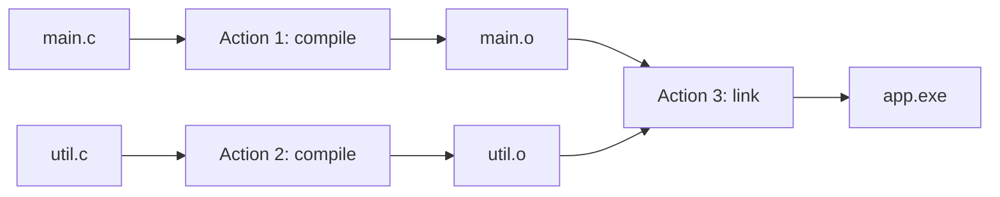

A large codebase has hundreds of thousands of these actions.

### 2. Every action is predictable

Give an action the same command and the same input files, and it produces the same output files, every time and on any machine. Compiling the same `main.c` with the same compiler and flags gives an identical `main.o` today or tomorrow, on your laptop or on a CI server. This property is called being **deterministic**, and Bazel is designed so that its actions are.

So if someone already ran an action with exactly these inputs, their output is exactly what you would get, and you can use their result instead of running it again.

### 3. A fingerprint tells us if two actions are exactly the same

To know that two actions match down to every byte of every input, we use a hash function called SHA-256. It turns any data into a 64-character fingerprint:

```
"hello"   →  2cf24dba5fb0a30e26e83b2ac5b9e29e1b161e5c1fa7425e73043362938b9824
"hello!"  →  ce06092fb948d9ffac7d1a376e404b26b7575bcc11ee05a4615fef4fec3a308b
```

Change one character and the fingerprint changes completely. Two different inputs practically never share a fingerprint.

Bazel fingerprints everything that affects an action (the command, the environment, and the fingerprint of every input file) and combines them into one fingerprint called the **action key**:

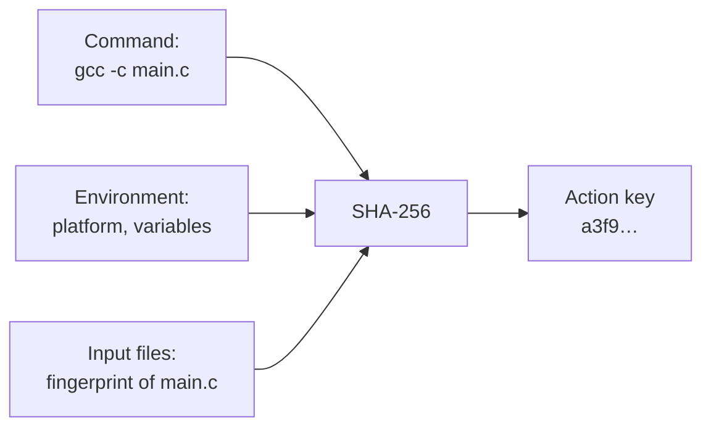

The same action key means exactly the same work. If anyone edits `main.c`, its fingerprint changes, the action key changes with it, and the old result can't be reused by mistake.

### 4. A server remembers every result

Anvil keeps two lookup tables on disk:

| Table | Key | Value | Example |
|---|---|---|---|
| Action Cache | action key | the list of output files and their fingerprints | `a3f9…` → `main.o` is `7c1e…` |
| CAS (Content-Addressable Storage) | a file's fingerprint | the file's actual bytes | `7c1e…` → the bytes of `main.o` |

Files are stored under their own fingerprint, so each file is stored once, however many actions produce it.

### 5. Before running an action, Bazel asks Anvil first

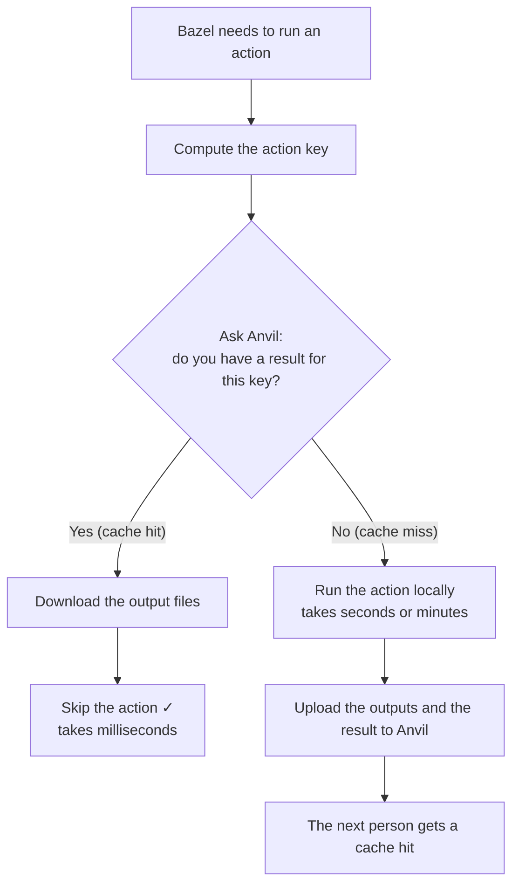

The first person to run an action pays for it once. Everyone after that, on any machine, downloads the result.

### 6. It can't give you a wrong answer

- Different inputs always produce a different key, so you can never receive a result for different code.
- Every uploaded file is checked against its fingerprint. Anvil recomputes the SHA-256 and rejects the upload if the bytes don't match, so corrupted or fake data never enters the cache.

### In one sentence

Anvil stores the results of build actions under a fingerprint of their inputs, so any machine about to run the same action can download the result instead of doing the work again.

## Why this matters

Big companies have huge codebases, and building everything from scratch can take an hour or more.

| Without a shared cache | With Anvil |
|---|---|
| Every developer rebuilds the same files | Each file is built once, then shared |
| Every CI run starts from zero | CI only builds what actually changed |
| A new teammate waits a long time on their first build | Their first build downloads finished work |
| Switching git branches means rebuilding | Results for both branches are already stored |

Google built systems like this internally so that tens of thousands of engineers can work in one giant codebase without waiting hours for builds. Anvil is my own implementation of the same idea, built from scratch to understand how it works.

## Where the idea came from

I wanted a project that matches the work of infrastructure teams, the engineers who build the tools other engineers use every day.

While reading about how large codebases stay fast, I kept finding the same answer: build caching and remote execution. Bazel, the open-source version of Google's internal build system Blaze, can send its work to a remote server using an open protocol. Several companies run servers like that, but I wanted to know what happens inside one:

- How do you store millions of files safely?
- How do you know a file isn't corrupted?
- What happens when two computers upload the same file at the same moment?
- How do you grow from one machine to many?

To answer those questions, I built one and tested it against the real Bazel instead of a pretend client.

## Words you'll see

| Word | Simple meaning |
|---|---|
| Build | Turning source code into a program that runs. |
| Bazel | The build tool. It is Anvil's customer: it sends requests, and Anvil answers. |
| Action | One small build job, like "compile `foo.go`". It has exact inputs and outputs. |
| Blob | Any file's contents, treated as a bag of bytes. |
| Hash (SHA-256) | A fingerprint of some data. Change one letter and the fingerprint changes completely. |
| Digest | A blob's ID card: its hash plus its size in bytes. |
| CAS (Content-Addressable Storage) | A storage room where every blob is filed by its fingerprint. |
| AC (Action Cache) | The notebook of answers: "action X produced these outputs." |
| Cache hit / miss | Hit: the answer was already stored. Miss: it wasn't, so the work must be done. |
| gRPC | The language Bazel and Anvil use to talk over the network. |
| ByteStream | The part of the protocol for sending big files in small chunks. |

## The big picture

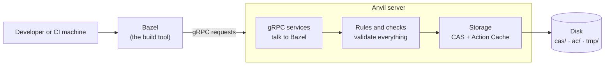

Anvil keeps two kinds of things:

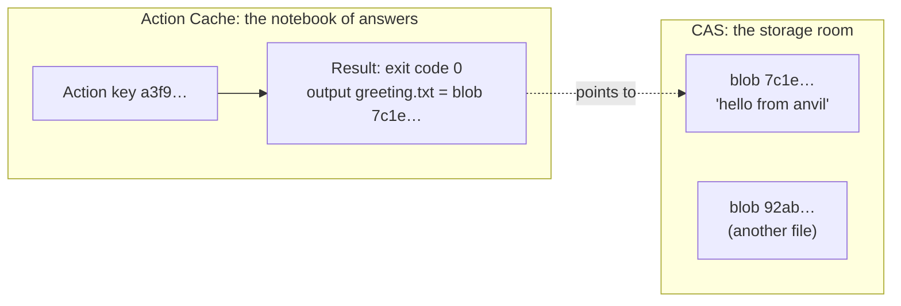

The Action Cache stores only pointers (digests) into the CAS, never file contents. That keeps answers tiny, and the same file is stored once even if a thousand actions produce it.

## How it works, step by step

### How Bazel decides what to ask for

Before running any action, Bazel takes everything that affects its result (the command, the environment, and the fingerprint of every input file) and turns it into one fingerprint, the action key.

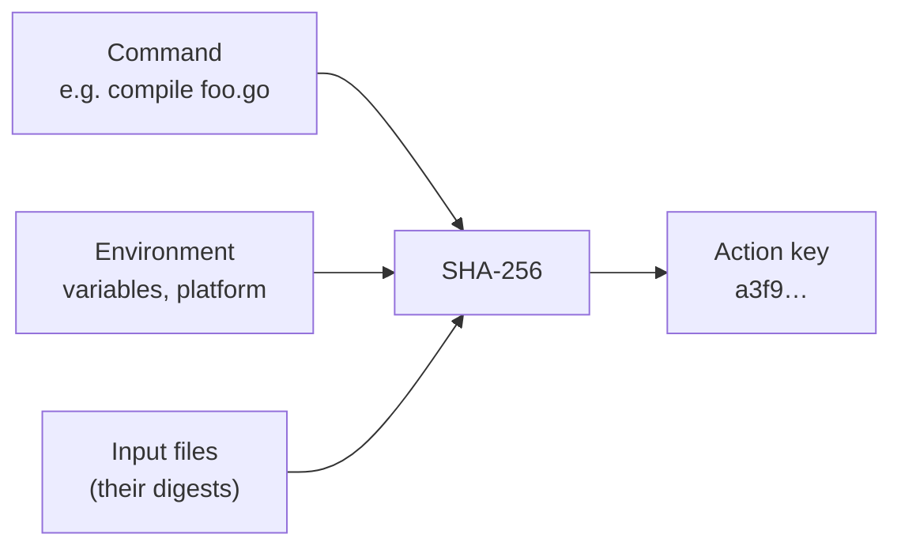

Same inputs always give the same key, and changing even one character in one file gives a completely different key. That is what makes reusing results safe.

### Flow 1: the first build (cache miss)

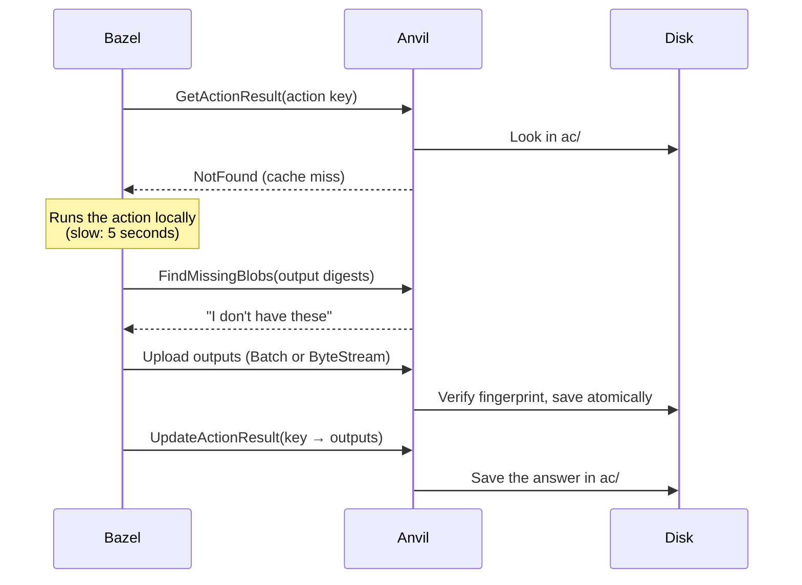

### Flow 2: the next build (cache hit)

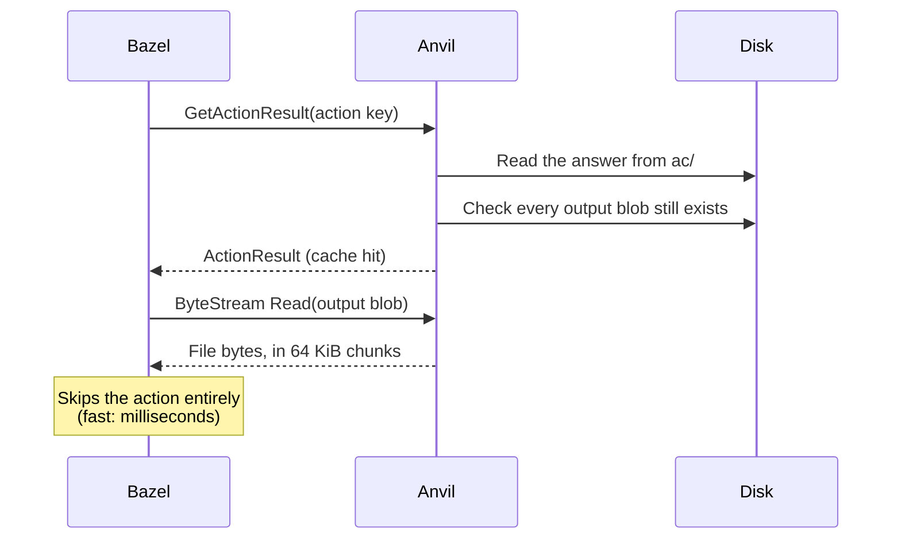

### Flow 3: uploading a big file safely

Big files arrive in many small chunks. Anvil checks each chunk as it arrives and accepts the file only if the final fingerprint matches.

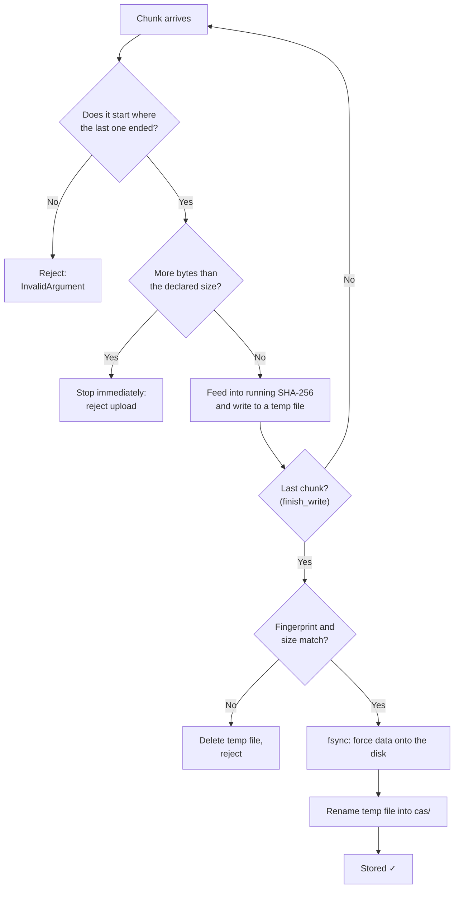

If the blob is already stored, Anvil answers "done" after the first chunk and skips the rest, which saves bandwidth on duplicate uploads.

### Flow 4: why "write to temp, then rename"?

If the server crashed halfway through writing a file directly into place, a broken file would sit there under the correct name, and every future build would download it.

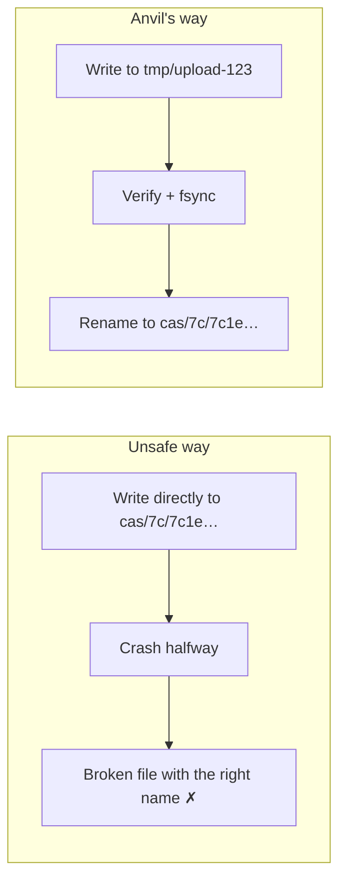

A rename on the same disk is **atomic**: anyone looking sees either no file or the complete file, never half of one. A crash before the rename only leaves a temp file, which gets cleaned up.

## Architecture

Anvil is built in three layers, and each layer only talks to the one directly below it.

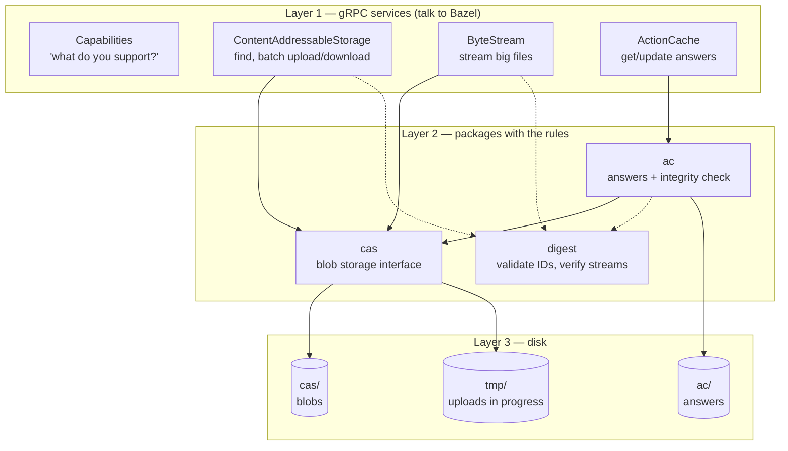

The handlers in layer 1 contain almost no logic. They translate protocol messages into Anvil's own types (validating them on the way), call layer 2, and turn results and errors back into protocol messages.

### Why the layers matter

The storage layer is hidden behind a Go interface:

```go
type Store interface {
    FindMissing(ctx, digests) (missing, error)
    Get(ctx, digest) (io.ReadCloser, error)
    Put(ctx, digest, io.Reader) error
}
```

Today there is one implementation, `DiskStore`. In milestone 4, a `ShardedStore` will spread blobs across several machines. It will implement the same interface, so the gRPC handlers and the Action Cache stay as they are. Going distributed adds one new piece and leaves the rest of the server untouched.

### What's stored on disk

```
anvil-data/
├── cas/                      ← blobs, filed by fingerprint
│   ├── 2c/
│   │   └── 2cf24dba5fb0a30e…  (64-character hash)
│   └── 7c/
│       └── 7c1e…
├── ac/                       ← answers (serialized ActionResult)
│   └── a3/
│       └── a3f9…
└── tmp/                      ← uploads in progress
```

Blobs are spread across 256 subfolders using the first two characters of the hash. Millions of files in a single folder make filesystems slow, and hash characters are effectively random, so this spreads them evenly. Git does the same thing inside `.git/objects`.

## Design decisions

| Decision | Why | Trade-off |
|---|---|---|
| Store blobs as plain files named by hash | Blobs never change once written, so a filesystem fits naturally and there's no database to run. | Very small blobs waste some disk space. |
| Verify every upload with SHA-256 | The client is never trusted, and bad data must never enter the cache. | Costs CPU on every upload. |
| Verify while streaming | A 2 GB file is never loaded into memory; bytes are hashed as they arrive. | Slightly more complex code. |
| Temp file → fsync → rename | A crash can never leave a half-written blob. | fsync makes writes slower. |
| The Action Cache checks outputs on every read | A hit pointing at a missing file would break the build, while a miss only costs time. | One extra existence check per lookup. |
| Corrupt entries count as misses | Bazel rebuilds, and the next upload overwrites the bad entry, so the cache repairs itself. | The replacement is silent, so it should also be logged. |
| No resumable uploads | Keeping partial uploads across requests adds a lot of complexity for little gain on a local cache. | An interrupted upload restarts from zero. |
| Early return for existing blobs | Anvil doesn't receive data it already has. | None in practice; Bazel handles it. |
| Standard library first | Fewer dependencies to trust, update, and explain. | Some code that a library would provide is written by hand. |
| One error-mapping function | Every internal error becomes the correct gRPC code in one place, and Bazel reacts differently to each code. | Errors must be wrapped consistently with `%w`. |

## Keeping it safe

Anvil treats every request as possibly wrong or malicious.

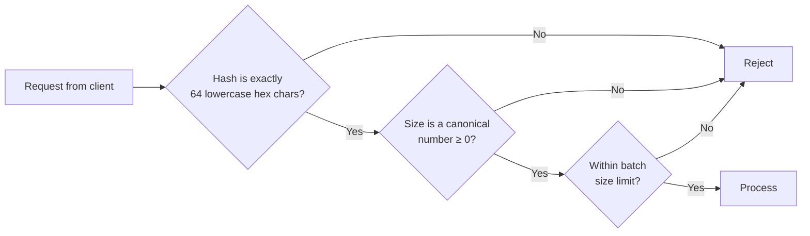

| Attack or mistake | What Anvil does |
|---|---|
| Path traversal: a "hash" like `../../Windows/System32/x` | Only exactly 64 lowercase hex characters are accepted, so a hash can never become a dangerous file path. |
| Lying about content: sending different bytes than the digest promises | The upload is hashed and rejected on mismatch. Nothing is stored. |
| Endless upload: declaring 5 bytes, then sending 50 GB | The upload is stopped the moment it exceeds the declared size. |
| Sneaky batch: a negative size to make an oversized batch look small | Every digest is validated before sizes are added up, so the limit uses only trusted numbers. |
| Gaps in a stream: a chunk claiming to start at the wrong place | Offsets must be continuous, or the upload is rejected. |
| Duplicate names: `ABC…` vs `abc…` for the same hash | Only lowercase is accepted, so each blob has exactly one name. |

One risk remains for later. The Action Cache can't be verified the way blobs can, because you can re-hash a file but you can't re-hash an answer. Anyone allowed to write to the Action Cache could store a false result, which is called **cache poisoning**. Before Anvil is exposed beyond localhost, it needs TLS and authentication, ideally with only CI allowed to write results.

## Project structure

```
anvil/
├── cmd/
│   └── anvil/
│       └── main.go            ← starts the server: reads flags, wires layers, handles Ctrl+C
├── internal/
│   ├── digest/                ← the foundation: what a blob's ID is
│   │   ├── digest.go          ← Digest type, validation, SHA-256, the empty blob
│   │   ├── resource.go        ← parse ByteStream names like blobs/{hash}/{size}
│   │   ├── verify.go          ← Verifier: hash data as it streams in
│   │   └── proto.go           ← convert to and from the protocol's Digest type
│   ├── cas/                   ← the storage room
│   │   ├── store.go           ← the Store interface
│   │   └── disk.go            ← DiskStore: atomic, verified, safe for concurrent use
│   ├── ac/                    ← the notebook of answers
│   │   └── cache.go           ← ActionResult storage + output integrity check
│   └── server/                ← gRPC services (translation only)
│       ├── errors.go          ← internal errors → gRPC status codes
│       ├── capabilities.go    ← what Anvil supports
│       ├── cas.go             ← FindMissingBlobs, BatchUpdateBlobs, BatchReadBlobs
│       ├── bytestream.go      ← streaming Read, Write, QueryWriteStatus
│       └── ac.go              ← GetActionResult, UpdateActionResult
├── testdata/
│   └── hello/                 ← a tiny Bazel project for the end-to-end test
│       ├── MODULE.bazel
│       └── BUILD.bazel
├── go.mod / go.sum            ← module name and pinned dependency versions
└── README.md
```

Every package with logic has a `_test.go` file next to it. Code under `internal/` can only be imported by this project, so its details can change freely.

### The order it was built in

Each step depends only on the steps before it:

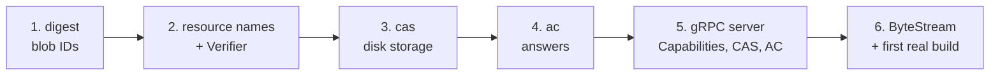

## Try it yourself

### You'll need

- [Go](https://go.dev/dl/) (latest stable)
- [Bazelisk](https://github.com/bazelbuild/bazelisk), installed as `bazel`

### Run the server

```bash
git clone https://github.com/mayankgts/anvil.git
cd anvil
go run ./cmd/anvil
```

You'll see:

```
INFO anvil listening addr=127.0.0.1:9092 dir=anvil-data
```

Flags:

| Flag | Default | Meaning |
|---|---|---|
| `-addr` | `localhost:9092` | Where to listen. Localhost only, by design. |
| `-dir` | `anvil-data` | Where blobs and answers are stored. |

### Watch the cache work

In a second terminal:

```bash
cd testdata/hello
bazel build //:greeting --remote_cache=grpc://localhost:9092   # slow: runs the action
bazel clean                                                      # forget local results
bazel build //:greeting --remote_cache=grpc://localhost:9092   # fast: served by Anvil
```

The second build prints `1 remote cache hit`.

The test action waits about 5 seconds on purpose, so the difference is easy to see:

```python
genrule(
    name = "greeting",
    outs = ["greeting.txt"],
    cmd_bat = "ping -n 6 127.0.0.1 > nul & echo hello from anvil > $@",
)
```

`cmd_bat` runs with Windows `cmd.exe`. On Linux or macOS, use `cmd = "sleep 5 && echo hello from anvil > $@"`.

## Results

| | First build | Second build (after `bazel clean`) |
|---|---|---|
| How the action ran | `1 local` | `1 remote cache hit` |
| Critical path | 5.19 s | 0.05 s |
| Total elapsed | 20.8 s | 0.9 s |

The fair comparison is the critical path. The first build's total time includes Bazel starting its own background process and loading packages, which has nothing to do with Anvil.

This is a small, deliberately slow test action. Measuring Anvil on a real open-source project is part of milestone 2.

## Testing

```bash
go test ./...
```

| Package | What the tests prove |
|---|---|
| `digest` | Bad hashes are rejected (uppercase, wrong length, non-hex, path traversal); `FromBytes` matches known fingerprints; resource names parse correctly with or without instance names; the Verifier catches wrong content, too few bytes, and too many bytes, even across chunks. |
| `cas` | Put then Get returns the same bytes; a failed upload stores nothing and leaves no temp files; the empty blob always exists; 20 simultaneous uploads of the same blob all succeed. |
| `ac` | Answers round-trip correctly; an answer pointing at a missing blob counts as a miss; corrupt entries count as misses; a newer answer replaces an older one. |
| `server` | Each service returns the right gRPC status code; batch limits can't be tricked with negative sizes; ByteStream tests run a real in-memory gRPC server (`bufconn`) covering offsets, limits, gaps, mismatches, and early return. |

There is also one end-to-end check: a real Bazel build, run twice against a running Anvil.

## Challenges

### Never trusting the client

The hash is used as a file name, so a malicious "hash" could point outside the storage folder. All validation happens in one place (`digest.New`), and every entry point goes through it, which closes that door everywhere at once.

### Two uploads of the same blob at the same moment

A race between writers is normally a hard problem. Content addressing makes this one easy: both uploads contain identical bytes by definition, so it doesn't matter which rename finishes last. If a rename fails but the blob now exists, the other upload won, and Anvil treats that as success.

### Streaming without loading files into memory

gRPC delivers a stream of messages, but the storage layer wants a normal `io.Reader`. A small adapter (`writeReader`) pulls the next message whenever it runs out of data and checks offsets as it goes, so the storage code never knows the data is coming over the network.

### A subtle batch-limit bypass

Adding up sizes straight from the request let a negative size hide a large blob inside a "small" batch. The fix was to validate every digest first and add up only trusted sizes. A test now guards it.

### Windows behaves differently

Windows refuses to rename a file that is still open, so files must be closed before the final rename. It can also refuse a rename if a reader has the destination open at that instant. Linux has neither problem.

### Reusing buffers safely

Reusing one buffer for every ByteStream chunk would be faster, but gRPC doesn't promise it's finished with a message when `Send` returns. Each chunk gets a fresh buffer, trading a little speed for safety.

### Measuring honestly

The first comparison looked like 20.8 s → 0.9 s, but most of those 20 seconds were Bazel starting up. The critical path, 5.19 s → 0.05 s, is the number that reflects Anvil.

### Choosing what not to build

The protocol allows resumable uploads, compression, and multiple instance names. Leaving them out kept milestone 1 small and correct, and they're listed under known limitations.

## Roadmap

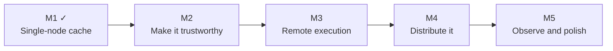

- [x] Milestone 1, single-node remote cache: CAS, Action Cache, ByteStream, and Capabilities, working with real Bazel.
- [ ] Milestone 2, make it trustworthy:
  - Size-limited storage with least-recently-used (LRU) eviction
  - Deep integrity checks for output directories
  - Prometheus metrics: hit rate, bytes served, latency
  - Benchmark on a real open-source project
- [ ] Milestone 3, remote execution: a scheduler queues actions, and Linux workers (in Docker) pull jobs, run them in a sandbox, and upload outputs. Jobs have leases, so a crashed worker's job gets retried.
- [ ] Milestone 4, distribution: several identical Anvil nodes share the CAS using consistent hashing, with each blob stored on two nodes. A build should still finish if one node is killed partway through.

  ```mermaid
  flowchart TB
      B["Bazel"] --> N1["Anvil node 1"]
      B --> N2["Anvil node 2"]
      B --> N3["Anvil node 3"]
      N1 <--> N2
      N2 <--> N3
      N1 <--> N3
      N1 --> D1[("blobs A–F")]
      N2 --> D2[("blobs G–P")]
      N3 --> D3[("blobs Q–Z")]
  ```

- [ ] Milestone 5, observability and polish: OpenTelemetry tracing, a cache-miss explainer that compares two action keys and says why an action missed, benchmarks, and a design document.

### Known limitations (today)

- One namespace: the `instance_name` field is accepted but ignored.
- SHA-256 only, no compression.
- Interrupted uploads restart from zero.
- Output directories are checked one level deep.
- The cache grows without limit until eviction lands in milestone 2.
- No TLS or authentication, so it listens on localhost only.

## What I learned

- Naming data by its fingerprint gives deduplication, corruption detection, and safe retries with no extra machinery.
- Correctness depends on small details: fsync, atomic renames, offset checks, and canonical number formats.
- Interfaces make growth cheap. The storage layer can move from one disk to many machines without touching the code above it.
- Unit tests prove each piece works, and a real Bazel build proves the pieces fit together.
- Error codes are part of the protocol. `NotFound` from the Action Cache is how the protocol says "cache miss."

## License

To be added.
